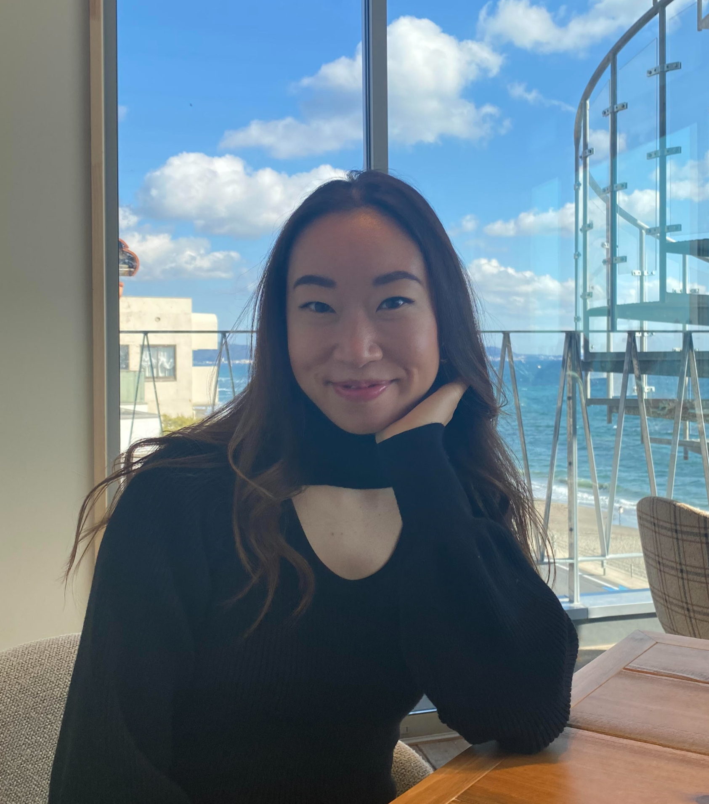

# About Me - 私を次のデジタルマーケッターとして

ファッションは自己表現の手段であるだけでなく、自信を育むツールでもあると考え、幼い頃からファッションに情熱を持ち続けてきました。この情熱が、小売Eコマースの世界へ踏み出すきっかけとなりました。革新的なツールやテクノロジーを活用したデジタルマーケティング戦略によって、ブランドの可視性と顧客エンゲージメントを高めることに強みを持っています。

Eコマーススペシャリストとして5年以上の経験を持ち、フロントエンドとバックエンドの両方のオペレーションを管理してきました。具体的な業務は、ウェブサイト管理、メールマーケティング、コンテンツ制作、顧客対応、在庫管理、出荷物流、決済処理など多岐にわたります。また、統一感のあるビジュアルアイデンティティを実現するため、商品撮影のディレクションも担当しました。

継続的な学びを大切にする姿勢から、ファッションデザインとパターンメイキングの勉強を進めながら、英語力とデジタルマーケティングのスキルも磨いてきました。今後も小売Eコマース分野でキャリアをさらに伸ばし、専門知識を活かしてビジネスの成長とイノベーションに貢献していきたいと考えています。

## 職務経験

### Mavi Jeans Canada

**2024年4月 - 現在**

顧客サービスと小売店舗運営を担当。お問い合わせ対応、返品処理、在庫管理、日次KPI売上レポートの作成を通じて、店舗業績の向上に貢献しました。

### PVH Japan Ltd.

**2022年12月 - 2024年3月**

サードパーティEコマースのバックオフィス管理と、ウェブサイトバナーおよびメールキャンペーン向けコンテンツカレンダーの運用を担当。フォトグラファーやスタイリストと連携し、商品撮影のディレクションを行いました。

### Acushnet Japan, Inc.

**2019年12月 - 2022年12月**

Titlest Eコマースサイトのディレクションを担当し、在庫管理や注文出荷処理を行いながら、ブランドイメージの一貫性を保持しました。メールマーケティングによって売上を60%向上させ、顧客データ分析によってウェブサイトのトラフィックを10%増加させました。

### Forever 21 Japan Retail

**2017年10月 - 2019年10月**

商品コピーの作成を担当し、カスタマーサービスチームや商品チームと連携して不良品対応を管理しました。KPI達成に向けて、SNSコンテンツの作成とデータ分析を行いました。

## 学歴

### Greystone College

**2024年3月 - 現在**

カナダ バンクーバー

デジタルマーケティング ディプロマ

### Esmod Japon

**2020年4月 - 2021年3月**

日本 東京

ファッションデザインおよびパターンメイキング 認定証

### J.F. Oberlin University

**2014年4月 - 2018年9月**

日本 東京

教養学部 学士

### California University, Monterey Bay

**2016年8月 - 2017年5月**

アメリカ カリフォルニア

国際交流プログラム

## ツールとブランド一覧

