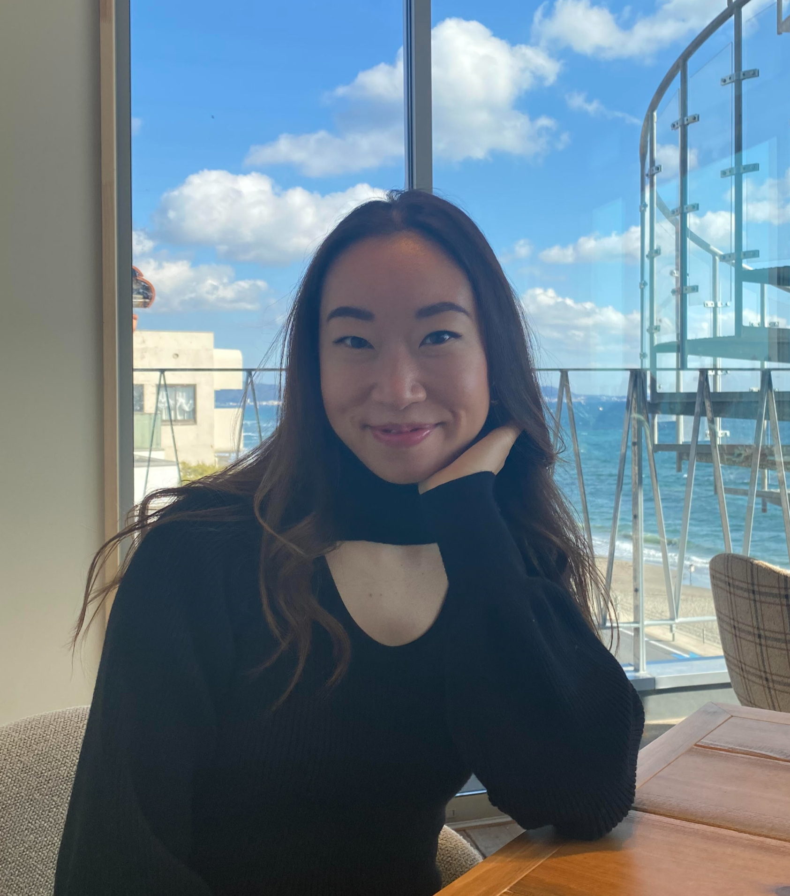

# About Me - Your Next Digital Marketer

I have always been passionate about fashion, seeing it not only as a form of self-expression but also as a tool for building confidence. This passion inspired my journey into retail e-commerce, where I excel at leveraging digital marketing strategies to enhance brand visibility and customer engagement through innovative tools and technologies.

With over five years of experience as an E-commerce Specialist, I have managed both frontend and backend operations. My work includes website management, email marketing, content creation, customer inquiries, inventory management, shipping logistics, and payment processing. I have also directed product photography shoots for a cohesive visual identity.

In my commitment to continuous learning, I pursued studies in fashion design and pattern making while advancing my skills in English and digital marketing. I look forward to furthering my career in retail e-commerce and contributing my expertise to drive business growth and innovation.

## Work Experience

### Mavi Jeans Canada

**April 2024 - Present**

Provided customer service and retail store management, handling inquiries, returns, inventory, and daily KPI sales reports to boost business performance.

### PVH Japan Ltd.

**Dec 2022 - Mar 2024**

Managed third-party e-commerce back offices and content calendars for website banners and email campaigns. Collaborated with photographers and stylists to direct photo shoots.

### Acushnet Japan, Inc.

**Dec 2019 - Dec 2022**

Directed Titlest e-commerce site, managing inventory, order fulfillment, and ensuring brand consistency. Boosted sales by 60% through email marketing and increased website traffic by 10% through customer data analysis.

### Forever 21 Japan Retail

**Oct 2017 - Oct 2019**

Wrote product copy and managed defective items with customer service and product teams. Created social media content and analyzed data to meet KPIs.

## Education

### Greystone College

**March 2024 - Present**

Vancouver, Canada

Diploma in Digital Marketing

### Esmod Japon

**Apr.2020–Mar.2021**

Tokyo, Japan

Certificate of Fashion Design and Pattern Making

### J.F. Oberlin University

**Apr.2014–Sept.2018**

Tokyo, Japan

Bachelor of Liberal Arts Administration

### California University, Monterey Bay

**Aug.2016–May.2017**

California, USA

International Exchange Program

## Tools and Brands Overview

