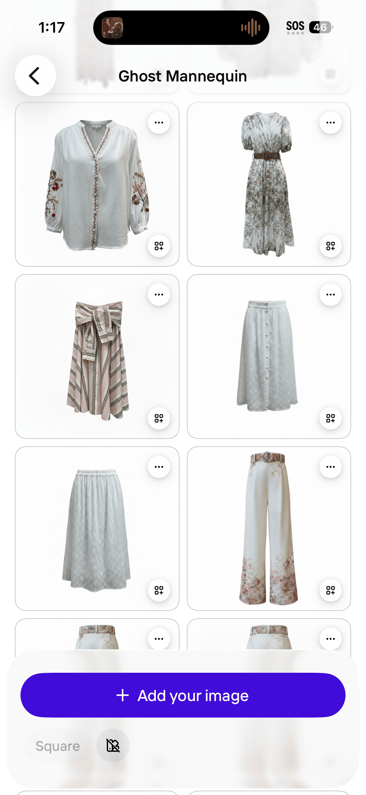
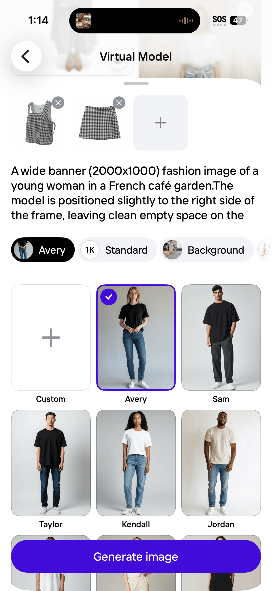
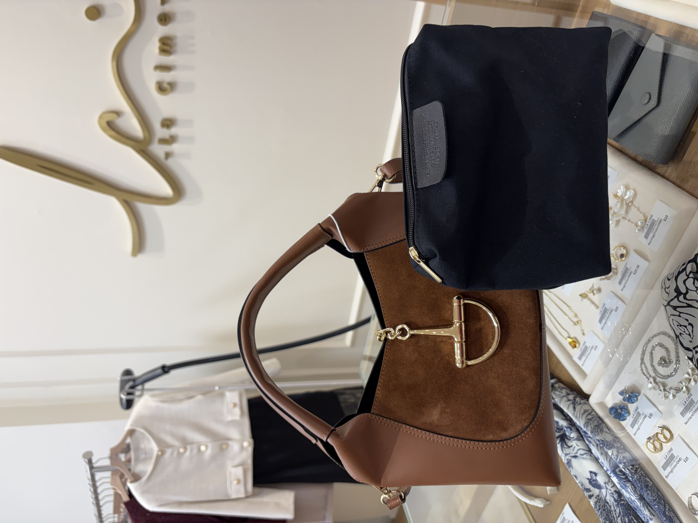
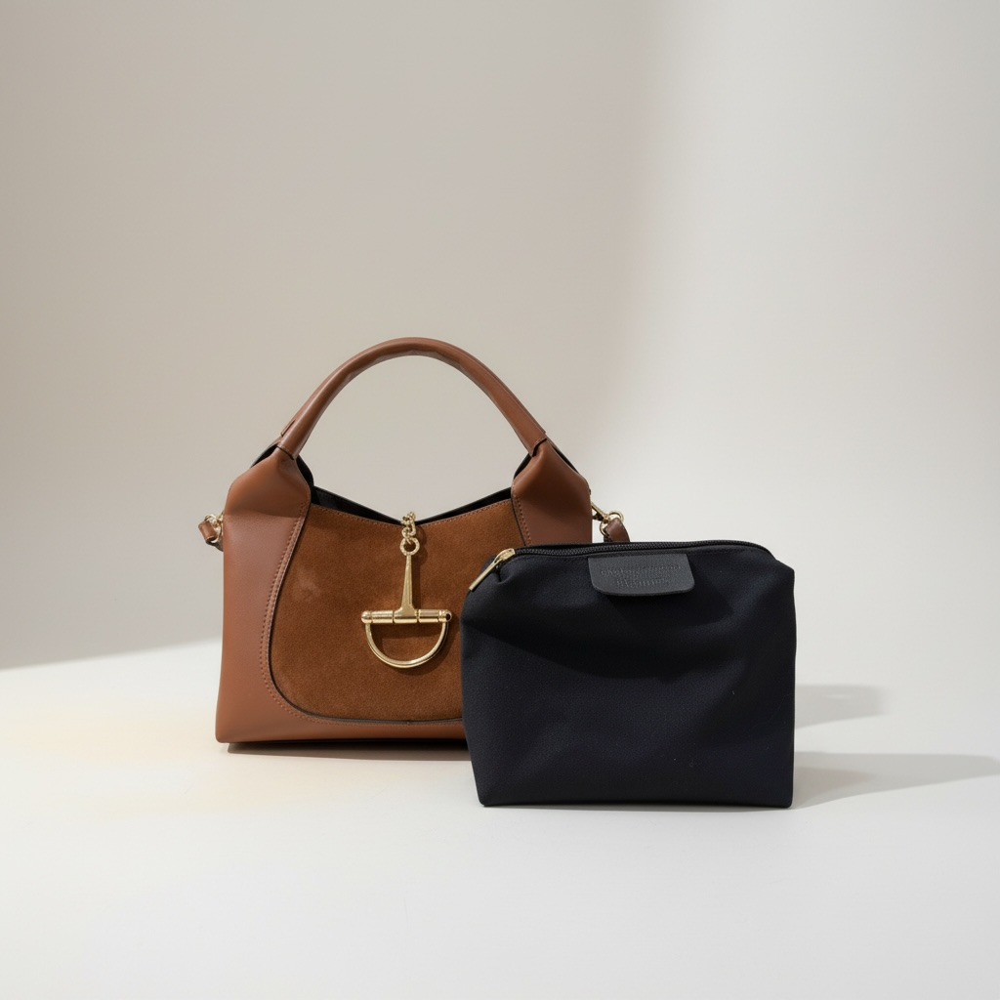
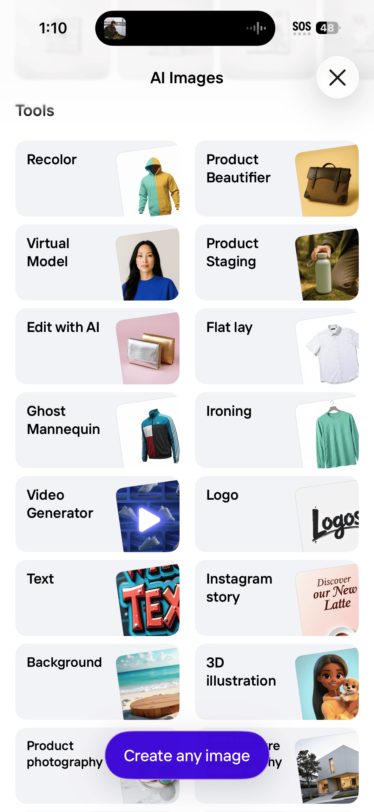

---
build:
  publishResources: false # pristine originals are source-only; templates publish processed variants on demand
title: AI Visual Creation
description: "Created AI-assisted product visuals for online stores, covering campaign imagery, ghost-mannequin apparel photography, and studio-style product shots."
summary: Produced digital product visuals for e-commerce use, including AI-assisted campaign imagery, ghost mannequin apparel photos, and studio-style product presentations.
tags:
  - AI Visual Content
weight: 7
featureimage: "images/01.jpg"
images: ["images/01.jpg"]
---

Produced digital product visuals for e-commerce use, including AI-assisted campaign imagery, ghost mannequin apparel photos, and studio-style product presentations.




