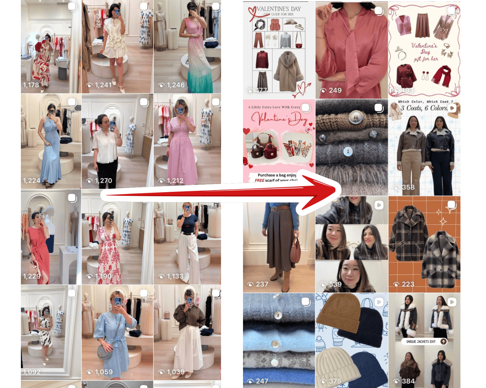
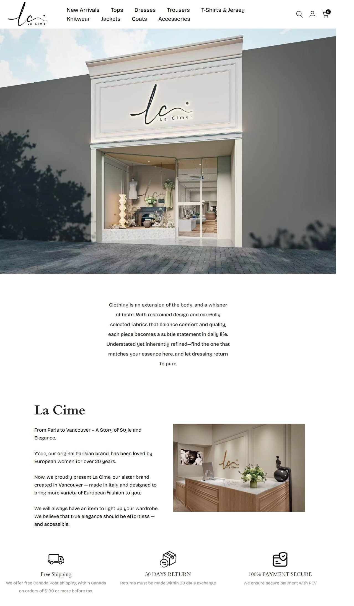

---
build:
  publishResources: false # pristine originals are source-only; templates publish processed variants on demand
title: "Brand Identity & Social Direction"
description: "Shaped the brand’s visual identity through themed Instagram content, story highlight design, and social media direction aligned with the online storefront."
summary: "Helped shape the brand’s visual identity through themed Instagram content, story highlight design, branding pages, and cohesive social media direction aligned with the online storefront."
tags:
  - Branding
weight: 4
featureimage: "images/01.png"
images: ["images/01.png"]
---

Helped shape the brand’s visual identity through themed Instagram content, story highlight design, branding pages, and cohesive social media direction aligned with the online storefront.




