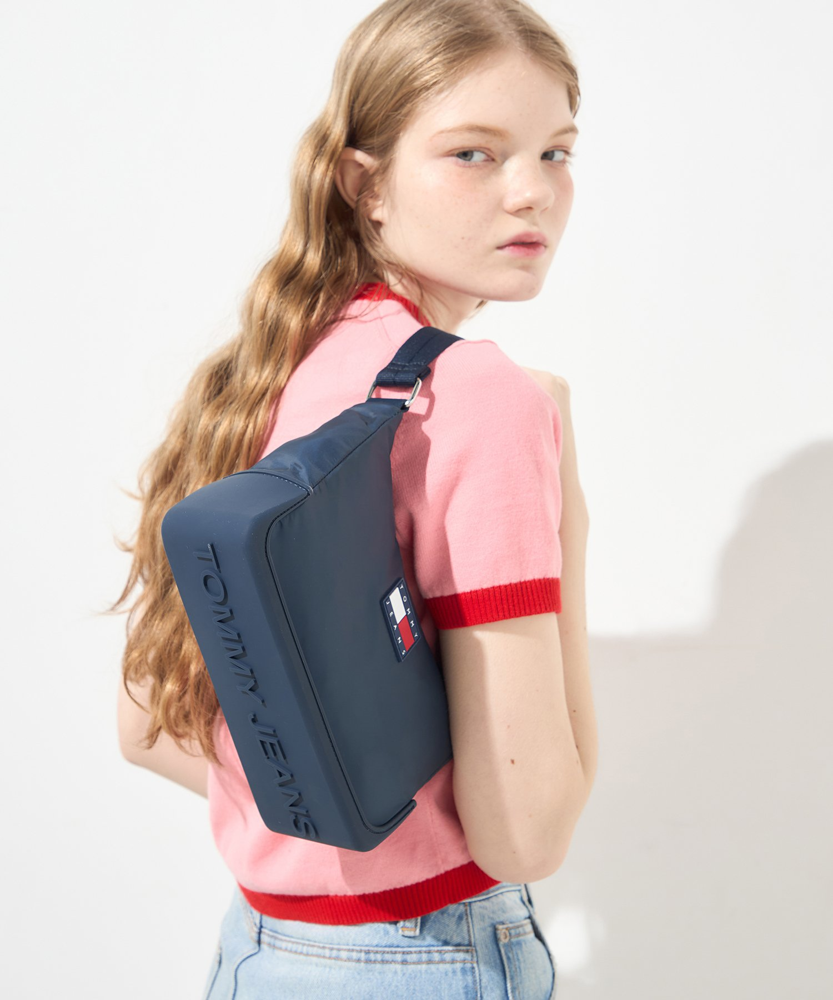

---
build:
  publishResources: false # pristine originals are source-only; templates publish processed variants on demand
title: Digital Marketing Campaign
description: "Planned and ran digital marketing campaigns for online retail, from paid ads and free shipping promotions to gift-with-purchase offers and special customer events."
summary: Planned digital marketing campaigns including online advertisements, free shipping promotions, exclusive sales, gift-with-purchase offers, and special customer events.
tags:
  - Digital Marketing
weight: 6
featureimage: "images/01.png"
images: ["images/01.png"]
---

Planned and ran digital marketing campaigns for an online fashion retailer, pairing paid channels with conversion-driving promotions.

**Objective:** lift online sales around seasonal moments without discounting the brand.

**Approach:** combined online advertising with offer mechanics — free-shipping thresholds, member-exclusive sales, gift-with-purchase promotions, and special customer events.

**Channels:** online ads, email, and on-site promotion.

**Result:** a recurring campaign calendar that kept banner, email, and on-site visuals telling the same story.




