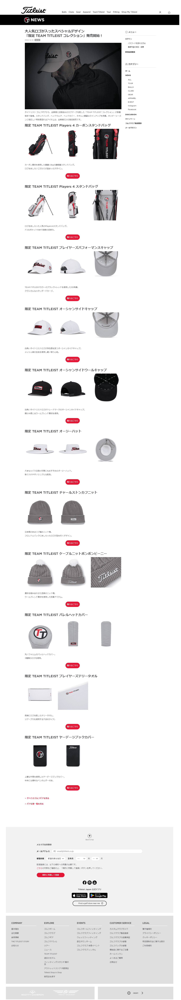

マーケティングチームと連携し、メール・ニュースレターキャンペーンを展開しました。ランディングページのデザインからビジュアル制作、コピーまで担当しています。

**目的：** ブランドの一貫性を保ったメール体験で、購読者をリピーターに変えること。

**アプローチ：** ランディングページのデザイン、マーケティングビジュアルの制作、コピーを担当し、チームと制作工程を調整しました。

**関連成果：** 別職務で担当したメールマーケティングでは、ECサイトの売上を60%向上させました（詳細はAboutページ）。




