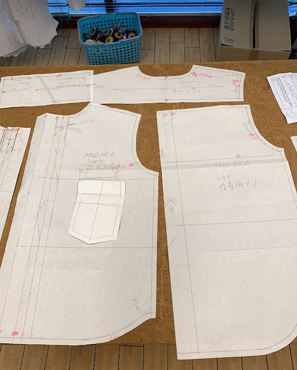
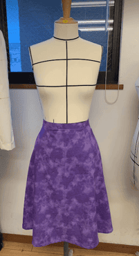
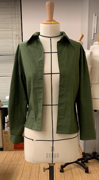
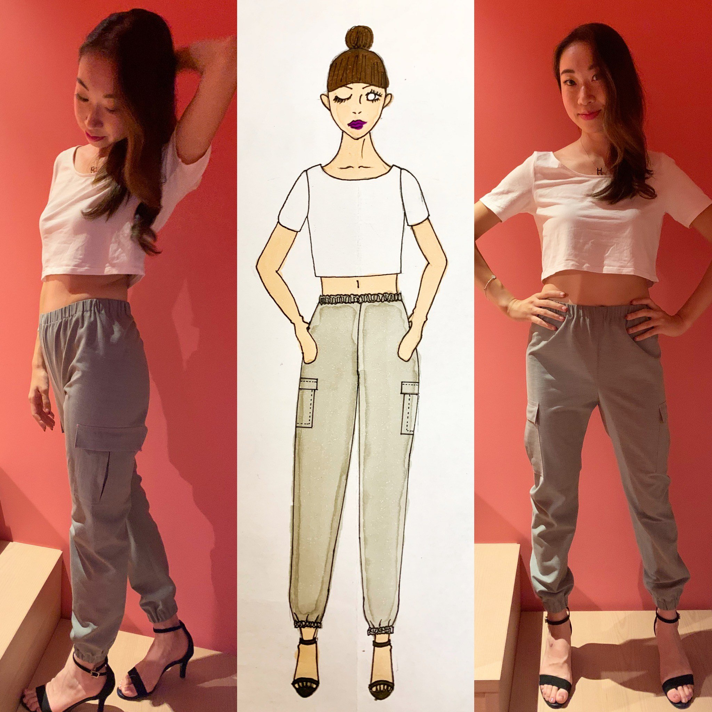
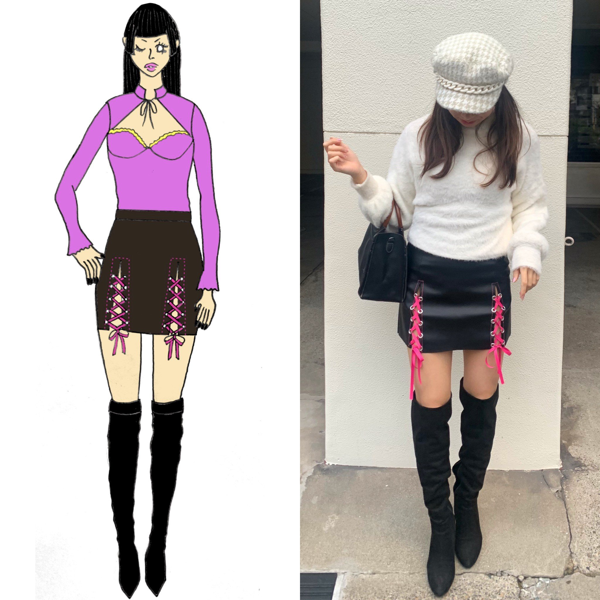
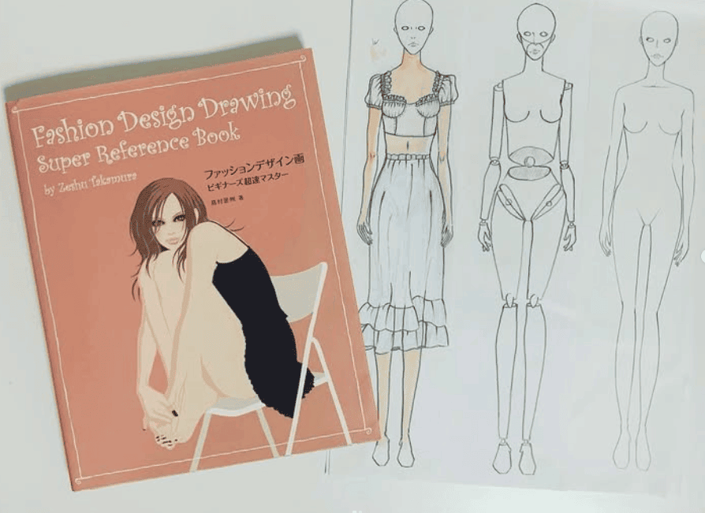
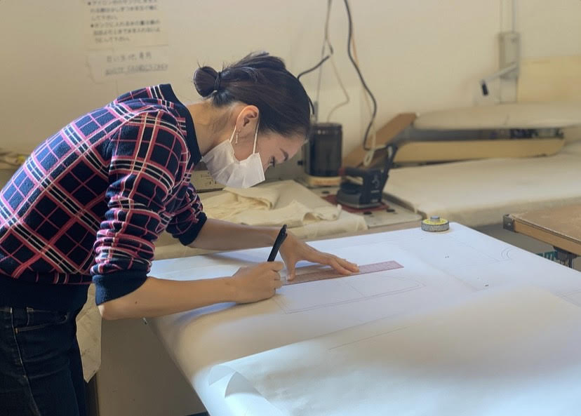

Studied fashion design and pattern making, building a foundational understanding of garment construction, silhouette, and materials. This knowledge supports a more thoughtful approach to e-commerce direction, visual merchandising, and online customer experience.




