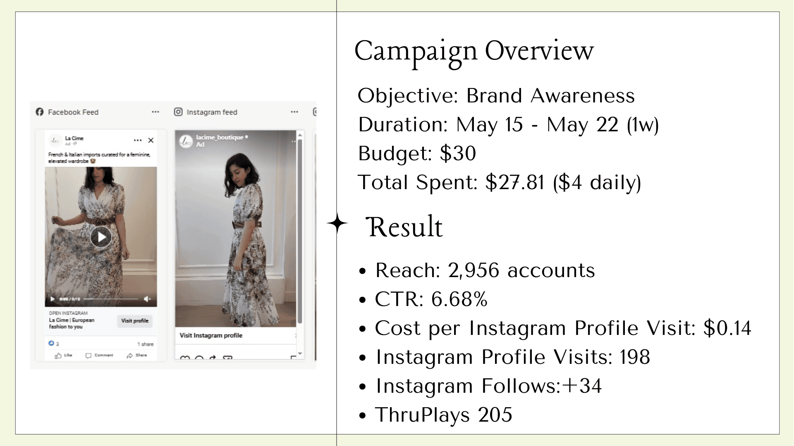
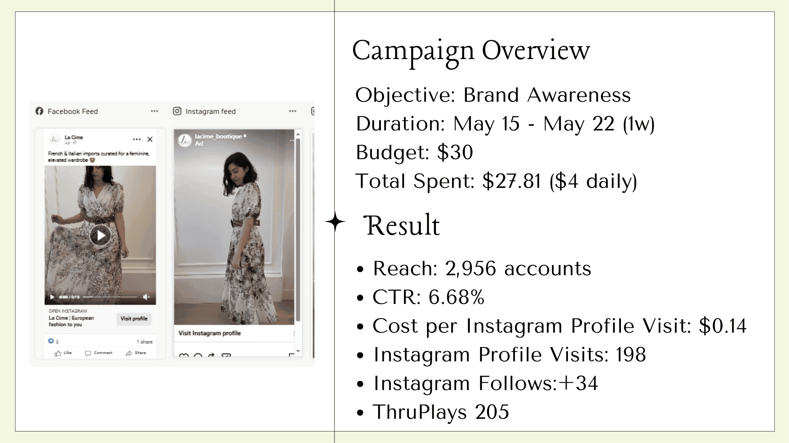

Meta Ads ManagerでPaid Social広告を一環して運用しました。オーディエンス設計から広告クリエイティブ、コピーまで担当しています。

**目的：** Metaの広告ネットワーク経由でECサイトへ質の高いトラフィックを集めること。

**アプローチ：** オーディエンスターゲティングを軸にキャンペーンを構成し、広告クリエイティブとコピーを内製で制作。キャンペーンカレンダーの企画も担当しました。

**チャネル・ツール：** Meta Ads Manager（Paid Social）、Google Analytics 4（GA4）によるパフォーマンス計測と顧客エンゲージメント分析。

**結果：** ターゲティング → クリエイティブ → 配信 → 計測まで回せる、繰り返し使えるキャンペーンプロセスを確立しました。




